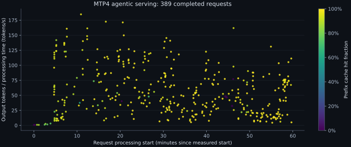
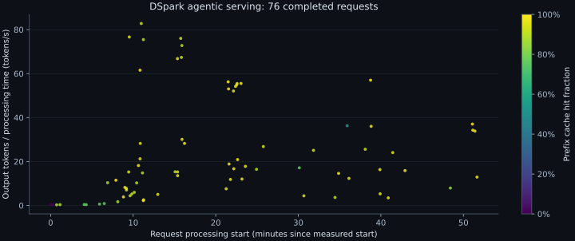

# oh-my-vllm

Run Qwen3.8-27B-FP8 on one B200 GPU with Chat Completions and Responses APIs.
Use streams, function tools, constrained output, prefix reuse, ordinary decoding, MTP4, or optional DSpark.
The maximum total input and output is 262144 tokens.

## Start

Install the [environment](docs/development.md), then set your local checkpoint:

```bash
export OH_MY_VLLM_MODEL="/path/to/Qwen3.8-27B-FP8"
scripts/with-env.sh cargo build --release --bin oh-my-vllm-zmq-worker
scripts/with-gpu.sh scripts/with-env.sh target/release/oh-my-vllm-zmq-worker serve
```

The default endpoint is `127.0.0.1:8000`.
See [service usage](docs/serving.md) for requests, tools, limits, and DSpark configuration.

## Request measurements

These one-hour observations use four concurrent OMP sessions per mode on source `3324a7f`.
Color shows the fraction of input tokens reused from the prefix cache.
The vertical axis is output tokens divided by request processing time. It is not decode-only throughput.
Four controller deadline aborts per mode are listed separately in [evidence](docs/acceptance.md#source-3324a7f).
The final framework performance gate is pending.





## Learn and verify

- [Interactive code journey](code-journey/README.md): thirteen Chinese chapters with current source and scheduler experiments.
- [Architecture](docs/architecture.md): ownership and background concepts.
- [Tests](docs/testing.md): correctness, capacity, service, and performance commands.
- [Acceptance](docs/acceptance.md): measured source scope and verification limits.
- [Document index](docs/README.md): guides and decisions.
- [Contributing](CONTRIBUTING.md): development checks and commit procedure.

[中文](README.zh.md)
