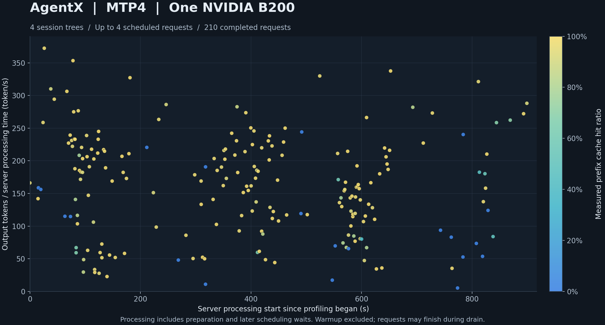

# oh-my-vllm

本项目提供在单张 NVIDIA B200 上运行 Qwen3.8-27B-FP8 的 Rust 服务.
Python worker 加载模型, 执行文本, 图片和视频推理.
支持普通解码或 MTP4, 并提供约束解码.

安装, 命令和 HTTP 请求见[服务指南](docs/serving.zh.md).
[Host KV cache](docs/kv-offload.zh.md) 使用动态 pinned 内存, 支持请求换出和前缀复用.

[English](README.md) · [贡献流程](CONTRIBUTING.zh.md)

## GPU 执行

Worker 使用[算子调度](docs/execution.zh.md).
包含 prefill 的 Execute 对其全部分片使用 Eager 执行.
仅含 decode 的 Execute 使用相同 native 算子的 CUDA Graph 录制和重放.
[全模型数值检查](docs/operators/evaluation.zh.md)将固定的短输入, MTP 恢复, 媒体和长上下文端点与直接 PyTorch FP64 计算进行比较.
[算子检查](docs/operators/microbench.zh.md)使用仓库内的 PyTorch fixture 和固定的理论延迟倍率门槛.

## AgentX trace 性能

此次 [AgentX 测量](docs/agentx.zh.md)在单张 B200 上使用 MTP4, 四个会话树和 900 秒正式采样.
每个点表示一个完成的请求. 颜色表示该请求实测的前缀缓存命中率.
服务端处理时间包含准备和后续调度等待, 不包含此前的接入排队和完整网络传输.

[请求 CSV](docs/assets/agentx-mtp4.csv) 包含图中数据和客户端计时.
字段定义和排除项见[测量流程](docs/agentx.zh.md#请求数据).

## 端到端 HTTP 性能

性能测量使用 24 种配置, HGX B200 标称速率及 [HTTP 测量流程](docs/performance.zh.md)中的参考计算.
完整计时覆盖提交, 服务准备, 推理, 采样, 传输及响应解析.
请求使用服务默认采样参数, auto 工具约束和客户端序号 seed.
请求不命中前缀缓存, token 预算为 32768, 最多同时运行 4 个请求.

Benchmark 使用 `http-reference-v4` 及[文档规定的假设](docs/performance.zh.md#内存).
源码 `0adf95f4df308dd3` 已测量全部 24 种配置.
表格记录一次完整测量运行.

运行时计算的 FA 容量为普通解码 1225 个 block, MTP4 1016 个 block.
本次运行使用 128 个 GDN slot 和 workload `serving-tools-v1`.
FA 容量使用 85% 的[服务显存预算](docs/serving.zh.md#cache-内存).
Prompt seed 为 `d32f3d5d2c4b4174a1bc2e7c155f0c03`.

| 模式 | Batch | 每请求输入 token 数 | 每请求输出 token 数 | HTTP 时间 (s) | 参考时间 (s) | 效率 |
|---|---:|---:|---:|---:|---:|---:|
| 普通解码 | 1 | 32768 | 64 | 1.850 | 0.697 | 37.68% |
| 普通解码 | 1 | 32768 | 8192 | 63.968 | 32.001 | 50.03% |
| 普通解码 | 2 | 32768 | 64 | 3.219 | 1.178 | 36.58% |
| 普通解码 | 2 | 32768 | 8192 | 75.111 | 35.359 | 47.08% |
| 普通解码 | 4 | 32768 | 64 | 5.826 | 2.131 | 36.57% |
| 普通解码 | 4 | 32768 | 8192 | 84.956 | 42.067 | 49.52% |
| MTP4 | 1 | 32768 | 64 | 1.588 | 0.572 | 36.04% |
| MTP4 | 1 | 32768 | 8192 | 21.181 | 10.384 | 49.03% |
| MTP4 | 1 | 65536 | 64 | 3.298 | 1.230 | 37.29% |
| MTP4 | 1 | 65536 | 8192 | 23.191 | 11.378 | 49.06% |
| MTP4 | 1 | 131072 | 64 | 7.774 | 3.107 | 39.97% |
| MTP4 | 1 | 131072 | 8192 | 29.503 | 14.558 | 49.35% |
| MTP4 | 2 | 32768 | 64 | 2.921 | 1.037 | 35.50% |
| MTP4 | 2 | 32768 | 8192 | 28.551 | 12.299 | 43.08% |
| MTP4 | 2 | 65536 | 64 | 6.468 | 2.362 | 36.51% |
| MTP4 | 2 | 65536 | 8192 | 35.897 | 14.086 | 39.24% |
| MTP4 | 2 | 131072 | 64 | 16.697 | 6.076 | 36.39% |
| MTP4 | 2 | 131072 | 8192 | 50.140 | 22.158 | 44.19% |
| MTP4 | 4 | 32768 | 64 | 8.481 | 1.972 | 23.26% |
| MTP4 | 4 | 32768 | 8192 | 41.356 | 15.841 | 38.30% |
| MTP4 | 4 | 65536 | 64 | 13.996 | 4.594 | 32.83% |
| MTP4 | 4 | 65536 | 8192 | 57.194 | 21.393 | 37.40% |
| MTP4 | 4 | 131072 | 64 | 33.439 | 12.071 | 36.10% |
| MTP4 | 4 | 131072 | 8192 | 79.504 | 33.644 | 42.32% |
