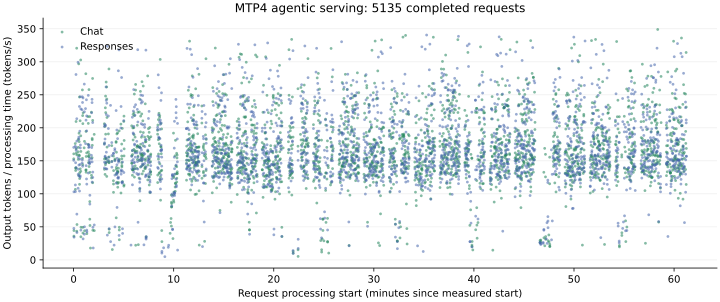
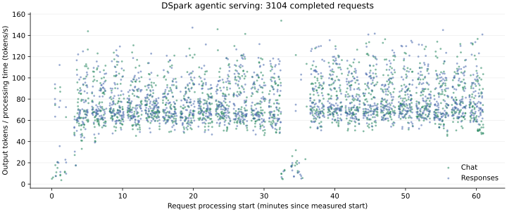
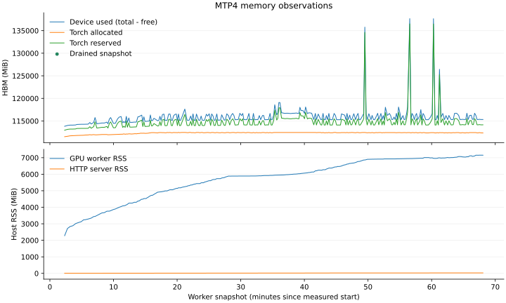
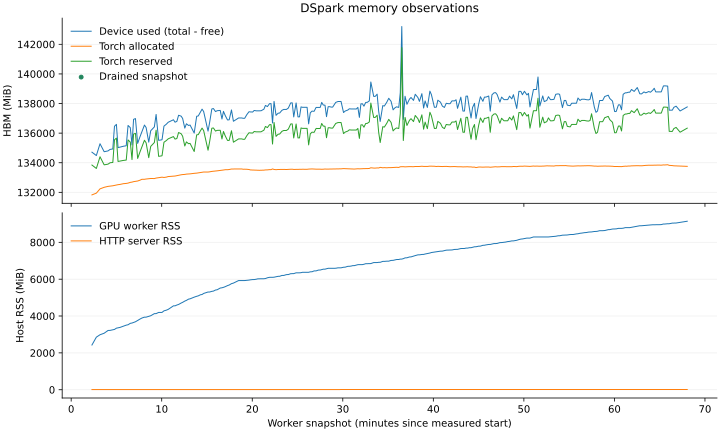

# oh-my-vllm

面向单张 B200 GPU 和 Qwen3.8-27B-FP8 的 Rust 推理框架.
Rust 负责 HTTP 服务, 请求调度和逻辑 KV 缓存.
Python 通过第三方 GPU 库和项目内核完成模型计算.
两个进程通过 ZMQ DEALER socket 交换 msgpack 消息.

目标模型包含 48 层 GDN 和 16 层 FA.
运行时使用 784-token 块, 支持输入与输出合计 262144 token.
支持普通解码, MTP4, DSpark, 前缀复用, 重计算抢占和约束生成.
HTTP 服务提供 Chat Completions 和 Responses API, 包括流式响应和函数工具.

## 启动

按 [开发指南](docs/development.zh.md) 安装环境并设置模型位置.
使用当前服务器上存在的 checkpoint 绝对路径:

```bash
export OH_MY_VLLM_MODEL="/path/to/Qwen3.8-27B-FP8"
scripts/with-env.sh cargo build --release --bin oh-my-vllm-zmq-worker
scripts/with-gpu.sh scripts/with-env.sh target/release/oh-my-vllm-zmq-worker serve
```

服务默认监听 `127.0.0.1:8000`.
[服务合同](docs/serving.zh.md) 说明限制, 工具和请求示例.
[测试指南](docs/testing.zh.md) 说明正确性和性能验证流程.

DSpark 使用不同的草稿 checkpoint 和相同的目标模型:

```bash
export OH_MY_VLLM_DRAFT_MODEL="/path/to/Qwen3.8-27B-DSpark"
scripts/with-gpu.sh scripts/with-env.sh target/release/oh-my-vllm-zmq-worker --speculative-mode dspark serve
```

[架构](docs/architecture.zh.md) 说明草稿算法和目标模型验证.

## 性能实测

当前十五行矩阵使用普通解码, MTP4, MTP4 prefix-hit 和 DSpark.
每组 batch 为 1/2/4, 输出为 4096 个 token. 源码 `ae070e4` 的 15 项 phase 案例全部通过.

普通解码和 DSpark 使用 32768 个输入 token.
MTP4 使用 32768, 131072, 以及命中 32144 个前缀 token 的 32768 输入组.

每个阶段完整预热两次, 测量五次.
三倍理论下界和 10% 波动门槛继续有效, 保留 prefix-hit prefill 倍率的既定例外.
[需求](docs/requirements.zh.md) 说明计时, [验收](docs/acceptance.zh.md) 标明实测源码范围.

这些测量使用源码 `ae070e4`, 固定依赖及全新项目 cache.
Prefill ratio 为墙钟时间除以理论下界. Decode TPS 每个请求计入 4095 个 token.
Decode theoretical % 为理论下界除以墙钟时间, 再乘以 100.
Prefix-hit prefill 保留既定倍率例外.

| Mode | Input | Batch | Prefill s | Prefill ratio | Decode TPS | Decode theoretical % |
|---|---:|---:|---:|---:|---:|---:|
| ordinary | 32768 | 1 | 1.270908 | 2.877 | 116.512 | 44.055 |
| ordinary | 32768 | 2 | 2.536588 | 2.871 | 221.765 | 45.434 |
| ordinary | 32768 | 4 | 5.194854 | 2.940 | 377.875 | 44.680 |
| mtp4 | 32768 | 1 | 1.290341 | 2.839 | 399.318 | 45.454 |
| mtp4 | 32768 | 2 | 2.575080 | 2.832 | 639.061 | 45.854 |
| mtp4 | 32768 | 4 | 5.282247 | 2.905 | 1011.489 | 43.198 |
| mtp4 | 131072 | 1 | 7.371012 | 2.504 | 301.970 | 49.058 |
| mtp4 | 131072 | 2 | 14.911688 | 2.532 | 493.258 | 51.361 |
| mtp4 | 131072 | 4 | 29.508601 | 2.506 | 870.398 | 54.561 |
| prefix | 32768 | 1 | 0.039517 | 3.794 | 398.575 | 45.369 |
| prefix | 32768 | 2 | 0.063979 | 3.071 | 637.845 | 45.729 |
| prefix | 32768 | 4 | 0.127940 | 3.071 | 1046.448 | 44.990 |
| dspark | 32768 | 1 | 1.274439 | 2.850 | 174.037 | 39.055 |
| dspark | 32768 | 2 | 2.548581 | 2.850 | 253.051 | 39.814 |
| dspark | 32768 | 4 | 5.237884 | 2.929 | 427.346 | 41.485 |

517 项算子数值检查全部通过. 速度检查通过 514 项, 失败 3 项.
用户同意交付且暂不优化这些案例. 见[审计](docs/audit.zh.md#krn-07-小-normalization-shape).

## 长期 agentic 服务

当前测试为每种模式保留 4 个固定 oh-my-pi 会话, 至少持续 1 小时.
2 个会话使用 Chat, 2 个使用 Responses. Session ID 和历史保持连续.
不设请求数下限, 不单独预热. 首次请求的编译计入测量.

OMP 使用 `qwen3` tokenizer, `262144` context window 和运行时 provider usage 决定自动压缩.
任务和摘要使用 `max`, 映射为服务的 `xhigh`. 模型请求共享 4 并发上限.

独立审查接受源码 `ae070e4` 上每种模式的一个 3600 秒推理框架窗口.
MTP 有 407 个服务端完成及 5 个终止. DSpark 有 79 个服务端完成及 8 个终止.
计数包括停止尾部. OMP 任务结果不决定框架验收.

最终图片展示框架开始处理的时刻, 以及输出 token 数除以处理墙钟时间, 包含 reasoning token.
图片按任务和压缩用途标记, 不提供 API 颜色图例.

[框架一小时记录](bench/evidence/2026-10-13-framework-hour.json) 保留原始失败, 独立审查, 资源测量和限制.
Worker RSS 在一小时内增加. 这些结果不能证明内存平台或一小时之外的稳定运行.
8 个 agent sandbox 及其生成文件, 复制工具, cache 和自有镜像均已删除.









此重型测试不设性能门槛, 日常命令默认跳过.
[测试](docs/testing.zh.md#长时-agentic-服务) 说明流程和内存审查.

## 阅读

- [需求](docs/requirements.zh.md): 范围和验收条件.
- [架构](docs/architecture.zh.md): 职责, 数据流和实现决策.
- [验收](docs/acceptance.zh.md): 实测结果及源码身份.
- [开放工作](docs/handoff.zh.md): 当前状态和后续任务.
- [文档索引](docs/README.zh.md): 指南和决策记录.
- [交互教程](code-journey/README.zh.md): 13 个中文章节, 使用真实源码和调度实验.
- [贡献规则](CONTRIBUTING.zh.md): 检查和提交流程.

[验收索引](docs/acceptance.zh.md) 标明每次测量的源码和测试范围.
框架性能采用十五行 prefill / decode 测量和理论资源下界.
项目构建, 测试和推理均不使用 vLLM 实现.
正式验证使用完整原始记录.

服务器专属配置记入被忽略的 `LOCAL.md`.

[English](README.md)
