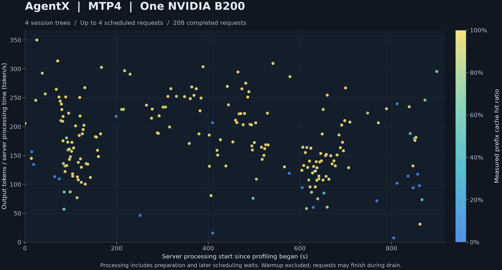

# Qwen results

## HTTP scope and method

This report contains the completed Qwen HTTP matrix and AgentX measurement from 2026-11-04 in Asia/Shanghai.
The [Qwen procedure](performance.md) gives the 24 HTTP configurations and `serving-tools-v1` workload.
This is one completed HTTP matrix, with one measurement per configuration.
The [AgentX section](#agentx-mtp4-concurrency-4) gives the accepted AgentX measurement.
These measurements use one GPU and do not show million-token capacity.

They apply only to the source and binary identities in this report, with the older BF16 cache and `http-reference-v5`.
They do not prove acceptance of the new FP8 cache, independent GDN checkpoints, or exact session-tail lifecycle.
The memory figures and recorded commands are historical evidence, not current capacity defaults or acceptance instructions.

Each row uses one B200 and concurrent HTTP requests.
Input and output lengths are for each request.
The Requests column gives the measured request count.
Each request has an uncached prefix.
The service has a limit of four active requests.
The step budget is 32768 tokens, and the context limit is 262144 tokens.

Sampling uses temperature 1.0, top-k 20, top-p 0.95, presence penalty 0.5, the repetition guard, and client-ordinal seeds.
Reasoning is off. Tool choice is auto.
The benchmark does required-tool checks and sends short warmup requests before measurement.

The recorded `perf_counter` timer includes thread creation, submission, preparation, queueing, model execution, and complete JSON response reads.
The timer does not include initialization or trace analysis.
Measured target prefill used Eager.
Ordinary target decode and MTP4 verification used CUDA Graphs.

Reference seconds use `http-reference-v5` and the [lower-bound calculation](performance.md#lower-bound-calculation).
This is a conservative theoretical resource estimate, not a proof of minimum physical latency.
Efficiency = reference seconds / full HTTP seconds × 100%.
Each case uses its own measured trace and acceptance counts.
Accepted/proposed gives the sum of draft token counts for that row's measured requests.
Ordinary decode has no draft acceptance ratio.

## HTTP measurements

| Mode | Batch | Input tokens | Output tokens | Requests | Full HTTP s | Reference s | Efficiency | Accepted/proposed |
|---|---:|---:|---:|---:|---:|---:|---:|---:|
| Ordinary | 1 | 32768 | 64 | 1 | 1.918283 | 0.697170 | 36.3435% | - |
| Ordinary | 1 | 32768 | 8192 | 1 | 65.872761 | 32.000966 | 48.5800% | - |
| Ordinary | 2 | 32768 | 64 | 2 | 3.461250 | 1.177495 | 34.0194% | - |
| Ordinary | 2 | 32768 | 8192 | 2 | 84.415055 | 35.359172 | 41.8873% | - |
| Ordinary | 4 | 32768 | 64 | 4 | 6.184695 | 2.130520 | 34.4483% | - |
| Ordinary | 4 | 32768 | 8192 | 4 | 84.649677 | 42.066511 | 49.6948% | - |
| MTP4 | 1 | 32768 | 64 | 1 | 1.623335 | 0.577251 | 35.5596% | 41/85 |
| MTP4 | 1 | 32768 | 8192 | 1 | 25.451533 | 11.665122 | 45.8327% | 6153/8150 |
| MTP4 | 1 | 65536 | 64 | 1 | 3.326920 | 1.213675 | 36.4804% | 44/74 |
| MTP4 | 1 | 65536 | 8192 | 1 | 37.566383 | 17.475012 | 46.5177% | 5391/11200 |
| MTP4 | 1 | 131072 | 64 | 1 | 7.856533 | 3.113426 | 39.6285% | 39/93 |
| MTP4 | 1 | 131072 | 8192 | 1 | 32.137645 | 14.958038 | 46.5437% | 6357/7336 |
| MTP4 | 2 | 32768 | 64 | 2 | 3.150883 | 1.048859 | 33.2878% | 85/156 |
| MTP4 | 2 | 32768 | 8192 | 2 | 30.378943 | 13.517884 | 44.4975% | 12272/16435 |
| MTP4 | 2 | 65536 | 64 | 2 | 6.476140 | 2.330873 | 35.9917% | 92/132 |
| MTP4 | 2 | 65536 | 8192 | 2 | 30.662030 | 13.775305 | 44.9263% | 12960/13684 |
| MTP4 | 2 | 131072 | 64 | 2 | 15.464214 | 6.081568 | 39.3267% | 90/140 |
| MTP4 | 2 | 131072 | 8192 | 2 | 50.892832 | 23.608458 | 46.3886% | 12348/16134 |
| MTP4 | 4 | 32768 | 64 | 4 | 5.978115 | 1.976476 | 33.0619% | 171/316 |
| MTP4 | 4 | 32768 | 8192 | 4 | 40.338825 | 17.017864 | 42.1873% | 24868/31577 |
| MTP4 | 4 | 65536 | 64 | 4 | 12.773463 | 4.585986 | 35.9025% | 175/301 |
| MTP4 | 4 | 65536 | 8192 | 4 | 50.147693 | 21.815545 | 43.5026% | 24832/31721 |
| MTP4 | 4 | 131072 | 64 | 4 | 30.787623 | 12.061681 | 39.1770% | 178/287 |
| MTP4 | 4 | 131072 | 8192 | 4 | 76.340771 | 34.797223 | 45.5814% | 25171/30358 |

All 12 configurations with 8192-token outputs have an efficiency of more than 40%.
The minimum is ordinary batch 2 at 41.8873%.
These are individual measurements, not repeated-run stability results.

## Failures and memory

All 24 configurations completed, with 56 measured requests and no measured request failures.
The benchmark examined complete output lengths, zero cached input tokens, tool frames, and runtime identities.
The manifest and trace digests agree with the records for each case.
A CPU audit calculated each complete v5 reference again and compared raw commit counts with service counters for each measured request.

Each mode launched one worker, with no worker restart.
The entry point and deadline guard exited with code 0. The owned service processes and observers all stopped.

The table gives this run's startup memory accounting, in bytes.
Initialized usage is a device-wide startup observation, not a per-case peak.
The benchmark did not measure per-case allocation peaks or pinned-host peaks.

| Mode | FA blocks | GDN blocks | FA bytes | GDN bytes | Planned bytes | Initialized used bytes |
|---|---:|---:|---:|---:|---:|---:|
| Ordinary | 1824 | 128 | 93717528576 | 30482952192 | 166469238272 | 166328991744 |
| MTP4 | 1608 | 128 | 87783112704 | 30482952192 | 168395416064 | 163583819776 |

Startup host-cache capacities were 124200480768 bytes for ordinary decode and 118266064896 bytes for MTP4.
The benchmark did not measure host-cache capacity changes during measurement.

## GPU observations

The observer saved 826 polling records: 814 records with query data and 12 query errors.
The errors occurred during initialization: five for ordinary decode and seven for MTP4.
The two error periods were before the applicable worker was ready and before measured requests.
Each record's epoch gives the start time of sequential inventory and process queries.
A poll is not an instantaneous snapshot.

The audit calculates UTC time ranges from recorded `perf_counter` values and server receive and generation-completion timestamps.
The observer and server use the same host wall clock.
The calculation uses a constant clock offset for each case and no wall-clock step.
The calculation does not supply recorded UTC timer readings.

Start times of records with complete query data are before and after each calculated HTTP range.
A start time does not give query completion times.
The records for these sampled HTTP ranges show no query errors or external GPU activity.
The maximum interval between polling starts in these ranges was 1.678123 seconds.

There are no query results for some initialization intervals.
Samples cannot show activity between polls or continuous inactivity during startup.
The external observation audit keeps the recorded errors and the calculation method.

## Provenance

Portable artifact name: `qwen-matrix24-formal-20261104-72da-run1`.
Measured source commit: `72da086ebe7f4d2e198adc8741c10002db2eebe8`.
Prompt seed: `nightly-model-adapters-v1`.
The topology is TP1 on one B200, with 48 CPU threads on one NUMA node.
The external identity records the device UUID and checkpoint, tokenizer, executable, native module, workload, and configuration identities.

Driver: `590.48.01`. Memory clock: 3996 MHz. Power limit: 1000 W.
The run did not change device clocks or power settings.

Request timeout is 7200 seconds. Worker-step timeout is 600 seconds. Shutdown grace is 35 seconds.

The external command records keep the environment, resource selection, and deadline guard.
This command uses local path variables and the complete default matrix:

```bash
scripts/with-env.sh scripts/with-gpu.sh python -u -m development.serving.benchmark \
  --model "$MODEL_ROOT" --binary "$WORKER_BINARY" \
  --artifacts "$ARTIFACT_ROOT" \
  --prompt-seed nightly-model-adapters-v1 --mamba-blocks 128
```

The report records source, executable, native module, checkpoint, and tokenizer identities independently.
The native manifest digest includes all seven complete manifests, with source and library identities.
Nested identity digests use UTF-8 JSON with sorted keys and separators `(",", ":")`.
Raw artifacts, commands, service logs, and audits are external to the repository.

| Identity | SHA256 |
|---|---|
| Source | `9a250d60e984bd108de09919ed0bcd19684120cce0c8a0b3b17b835abbba65f9` |
| Executable | `418cddf3e582db05cdf60d7f92d27bc1873fb3340c07fd3d70395254fb344572` |
| Native manifests | `15a55b2788ba13f93d451bbf15edeb37ddb3d315f7b966ae0a040050082815bf` |
| Checkpoint | `d26f1d65231264de91c0966777e2c6fa2658f72c278c50f40aead734ce092f4b` |
| Tokenizer | `f78b803474f10eb7a86741417823af5be59cf86f2b57db1869740e18c380bfdd` |
| Artifact ID | `1b7ab835de7a063e68f2fe8eb6da59abcdffe45f8aca3fce182c332b4ecfa549` |
| Identity file | `03e520cebc109fe56a41c9fba99791baba143bb0eefaff27fca54d7ad8b47005` |
| Command input templates | `2b3f98466d11acee8eb50187179c2a3dddbd2105ebc0e165b24ccd42949b9573` |
| Result audit | `18e40778299da0705469184802e83f9825b3a9a55e28202cb64d60efe8985877` |
| Observation audit | `7c87eec8bd93008b5d3c80ebc90c609f883e6a559c1fabb4efef0fec4608ad47` |

## AgentX MTP4, concurrency 4

This accepted measurement uses the [AgentX procedure](agentx.md) and only `qwen-agentx-formal-20261104-72da-run2`.
The harness is `agentx-harness==1.0.7`, with scenario `inferencex-agentx-mvp` and dataset `semianalysis_cc_traces_weka_062126_256k`.
The seed is 42. The concurrency setting is four session trees.
The measured HTTP concurrency peak was 4, calculated from raw request start and end timestamps.

Requests use streaming, `ignore_eos=true`, `reasoning_effort=off`, and seed 42 with service sampling defaults.
MTP4 uses 1608 FA blocks, 128 GDN blocks, a 32768-token step budget, and a four-request scheduling limit.
The context limit is 262144 tokens.
Measured prompts were 727–169289 tokens, and outputs were 23–10180 tokens.
The largest prompt plus output was 169416 tokens.

### Request results

Warmup completed 3 requests in 27.53 seconds. Its barrier grace limit was 1800 seconds.
Profiling continued for 900.001 seconds, then drain continued for 120.0 seconds.
The upstream result has `submission_valid=true`, `was_cancelled=false`, and `grace_period_timeout=true`.
The coordinator accepted this measurement with the scenario and HTTP rules.

| Request status | Count |
|---|---:|
| Profiling sent | 208 |
| Completed | 208 |
| Failed | 0 |
| Canceled | 0 |
| Incomplete | 0 |
| HTTP timeout | 0 |
| Context overflow | 0 |
| Skipped context overflow | 0 |
| Worker restarts | 0 |

Session trees were 4 sent, 3 completed, and 0 canceled. One tree was not reported completed.
The drain reached its time limit with no active HTTP requests.
All 208 CSV rows agree with raw SSE records, full response IDs, finish markers, usage, cache counts, and service metrics.
Service completion counts also agree for input, output, cached, and reasoning tokens.

Output rate is output tokens divided by server processing seconds.
Processing includes request preparation, later scheduling waits, and generation.
It does not include admission queueing or full network transport.
Prefix reuse is cached prompt tokens divided by prompt tokens.
The token-weighted prefix reuse was 88.9091%.

| Measurement | Minimum | P10 | Median | P90 | Maximum |
|---|---:|---:|---:|---:|---:|
| Output rate, tokens/s | 7.2561 | 95.6059 | 168.3942 | 257.7737 | 349.9074 |
| Prefix reuse | 0.0000% | 47.7951% | 97.8587% | 99.5968% | 99.8080% |
| Admission queue, s | 0.000055 | 0.000395 | 0.001078 | 0.012048 | 0.611372 |

The [CSV](assets/agentx-mtp4.csv) and figure contain one row and point for each completed profiling request.
Warmup requests are not included. Requests that completed during drain are included.
The published CSV uses LF line endings. All cells and row order are the same as the initial CSV.



### Resource observations and shutdown

This run used GPU7 and 48 CPU threads on NUMA1.
Recorded launch commands give the CPU allocation. There is no CPU affinity time series.
The observer saved 904 records: 899 records with full query data and 5 initialization query errors before worker readiness.

Records with full query data have start times before and after the profiling and drain range, with 783 records across that range.
The maximum interval between these starts was 3.541328 seconds.
These records have no query errors.
GPU7 compute records identify only this run's worker.

Record epochs are before sequential device and process queries. They do not give query completion times or show continuous exclusivity.
Activity on GPUs not used by this run does not reject this GPU7 measurement.

The entry point and guard exited with code 0 at 20:23:04.485106.
Cleanup verification at 20:28:12.111760 found no owned processes, process groups, sessions, IPC, GPU7 lock holder, or GPU7 compute.
The HTTP port refused connections. The two observers stopped.
Verification occurred 307.626654 seconds after entry exit.
This was more than the 120-second reserved estimate and before the window deadline.

After result processing, upstream shutdown used SIGKILL to stop its dataset manager. The full shutdown log is external.

### AgentX provenance

The measured commit and source, executable, native manifests, checkpoint, and tokenizer identities are the same as the HTTP identities in [Provenance](#provenance).
This AgentX section contains only run2 samples. AgentX run1 records are not included.
The initial result has `null` acceptance fields. The coordinator's decision records acceptance.

| AgentX identity | SHA256 |
|---|---|
| Identity file | `2b05acbd4999c5a61aae0096b24e81274bd03fbc2e0c1bc949b0b5703d0ef12d` |
| Harness command | `cd062913197a471d07b13c85a3639df0195dfd3a68a3e7e96f395c87a0138398` |
| Launch inputs | `ebffb6fb11fbbea929b9c5f1d423e50e64c7c0bdc14bd70890869eba7f0d5d71` |
| Upstream summary | `04df25335fcd8304bab8463898d7dc5d9bb8d7b5f713730953106050a73a15de` |
| Raw SSE | `738b6c501fe41a1fb3d4b5910b7fa7b2ea90302b9176c644f7ce369e2645be99` |
| Final result | `bbd1b0346c8707a3004ed39e8226576d11157c7ee259647f15b87123d18c47f8` |
| HTTP audit | `ee73fa8d8c791683c5438b2cec78a4fe8bddfe39ab5cb08ac91ed7be77f0d0b4` |
| GPU observations | `2f7b0ed02b4b24e8b1b69d90e14bd2d8cd99fbda78ebce14c7f0fc35f1084f0e` |
| Cleanup | `bdeb227c744a9ab6e829c6498ba6150d40d2934a74e47c456b4d983997c419ce` |
| Coordinator acceptance | `8bb281ba445b25f78ac6b4a010c5f47b1d7c039be980943d1df34925f4fdbc74` |
| Initial CSV | `cb2acef306d16c5aafec124f41c965511fc0b624535dcee538f8eb4e61d1f0e9` |
| Published CSV | `323069938d896c4ac6d16238dee7f31058bbddd976b90bc12cc4dc83aadc2fad` |
| Figure | `c19f6f71b058d1ec2a81c6e76cfe2390580135490eaeb2ee6522fd3632851dde` |
