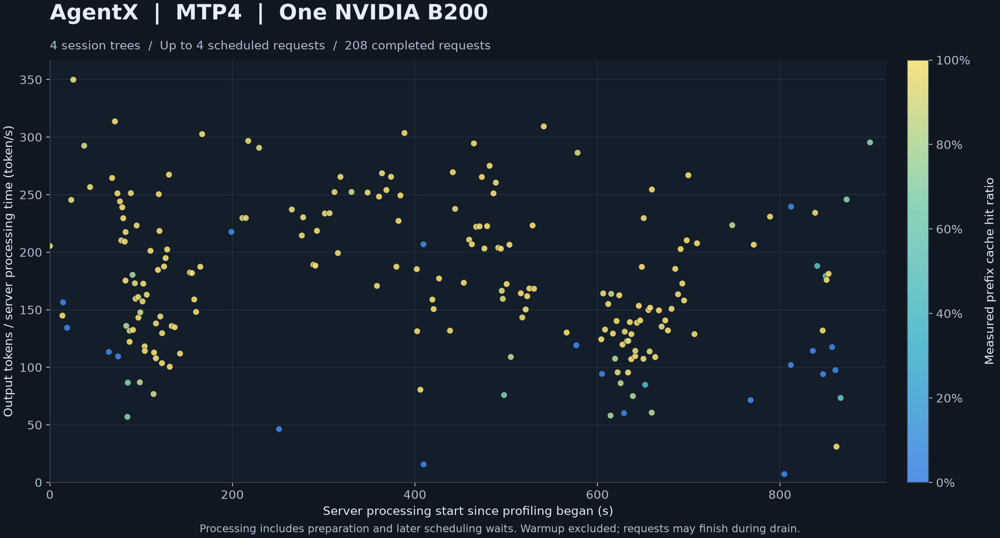

# Qwen 结果

## HTTP 范围和方法

本报告包含 Asia/Shanghai 时区 2026-11-04 完成的 Qwen HTTP 矩阵和 AgentX 测量.
[Qwen 流程](performance.zh.md) 给出 24 个 HTTP 配置和 `serving-tools-v1` 工作负载.
这是一次已完成的 HTTP 矩阵, 每个配置测量一次.
[AgentX 章节](#agentx-mtp4-并发-4) 给出验收通过的 AgentX 测量.
这些测量使用单张 GPU, 不证明百万 token 容量.

每行使用一张 B200 和并发 HTTP 请求.
输入和输出长度均为每个请求的长度.
请求数列给出被测请求数量.
每个请求的前缀均未缓存.
服务的活跃请求上限为四个.
每步 token 预算为 32768, 上下文限制为 262144 tokens.

采样使用 temperature 1.0, top-k 20, top-p 0.95, presence penalty 0.5, 重复保护和客户端序号种子.
推理模式关闭. 工具选择为 auto.
基准在测量前执行必选工具检查, 并发送短预热请求.

已记录的 `perf_counter` 计时包含线程创建, 提交, 准备, 排队, 模型执行和完整 JSON 响应读取.
计时不包含初始化或 trace 分析.
被测 target prefill 使用 Eager.
普通 target decode 和 MTP4 verification 使用 CUDA Graph.

理论参考秒数使用 `http-reference-v5` 和[下界计算](performance.zh.md#下界计算).
这是保守的理论资源估计, 并非最小物理延迟的证明.
Efficiency = 理论参考秒数 / 完整 HTTP 秒数 × 100%.
每个用例使用自己的实测 trace 和接受计数.
接受/提议给出该行全部被测请求的 draft token 计数之和.
普通解码没有草稿接受率.

本报告不提供与旧计量版本或单独开发点比较的加速估计.

## HTTP 测量

| 模式 | Batch | 输入 tokens | 输出 tokens | 请求数 | 完整 HTTP s | 理论参考 s | Efficiency | 接受/提议 |
|---|---:|---:|---:|---:|---:|---:|---:|---:|
| 普通 | 1 | 32768 | 64 | 1 | 1.918283 | 0.697170 | 36.3435% | - |
| 普通 | 1 | 32768 | 8192 | 1 | 65.872761 | 32.000966 | 48.5800% | - |
| 普通 | 2 | 32768 | 64 | 2 | 3.461250 | 1.177495 | 34.0194% | - |
| 普通 | 2 | 32768 | 8192 | 2 | 84.415055 | 35.359172 | 41.8873% | - |
| 普通 | 4 | 32768 | 64 | 4 | 6.184695 | 2.130520 | 34.4483% | - |
| 普通 | 4 | 32768 | 8192 | 4 | 84.649677 | 42.066511 | 49.6948% | - |
| MTP4 | 1 | 32768 | 64 | 1 | 1.623335 | 0.577251 | 35.5596% | 41/85 |
| MTP4 | 1 | 32768 | 8192 | 1 | 25.451533 | 11.665122 | 45.8327% | 6153/8150 |
| MTP4 | 1 | 65536 | 64 | 1 | 3.326920 | 1.213675 | 36.4804% | 44/74 |
| MTP4 | 1 | 65536 | 8192 | 1 | 37.566383 | 17.475012 | 46.5177% | 5391/11200 |
| MTP4 | 1 | 131072 | 64 | 1 | 7.856533 | 3.113426 | 39.6285% | 39/93 |
| MTP4 | 1 | 131072 | 8192 | 1 | 32.137645 | 14.958038 | 46.5437% | 6357/7336 |
| MTP4 | 2 | 32768 | 64 | 2 | 3.150883 | 1.048859 | 33.2878% | 85/156 |
| MTP4 | 2 | 32768 | 8192 | 2 | 30.378943 | 13.517884 | 44.4975% | 12272/16435 |
| MTP4 | 2 | 65536 | 64 | 2 | 6.476140 | 2.330873 | 35.9917% | 92/132 |
| MTP4 | 2 | 65536 | 8192 | 2 | 30.662030 | 13.775305 | 44.9263% | 12960/13684 |
| MTP4 | 2 | 131072 | 64 | 2 | 15.464214 | 6.081568 | 39.3267% | 90/140 |
| MTP4 | 2 | 131072 | 8192 | 2 | 50.892832 | 23.608458 | 46.3886% | 12348/16134 |
| MTP4 | 4 | 32768 | 64 | 4 | 5.978115 | 1.976476 | 33.0619% | 171/316 |
| MTP4 | 4 | 32768 | 8192 | 4 | 40.338825 | 17.017864 | 42.1873% | 24868/31577 |
| MTP4 | 4 | 65536 | 64 | 4 | 12.773463 | 4.585986 | 35.9025% | 175/301 |
| MTP4 | 4 | 65536 | 8192 | 4 | 50.147693 | 21.815545 | 43.5026% | 24832/31721 |
| MTP4 | 4 | 131072 | 64 | 4 | 30.787623 | 12.061681 | 39.1770% | 178/287 |
| MTP4 | 4 | 131072 | 8192 | 4 | 76.340771 | 34.797223 | 45.5814% | 25171/30358 |

全部 12 个输出为 8192 tokens 的配置效率均超过 40%.
最低为普通 batch 2, 效率 41.8873%.
这些是单次测量, 不是重复运行的稳定性结果.

## 失败和内存

全部 24 个配置完成, 共 56 个被测请求, 无被测请求失败.
基准检查了完整输出长度, 输入缓存 token 为零, 工具帧和运行时身份.
每个用例的 manifest 和 trace 摘要均与记录一致.
CPU 核账再次计算了每个完整 v5 理论参考, 并为每个被测请求比较了原始 commit 计数和服务计数.

每种模式启动一个 worker, 无 worker 重启.
入口和截止时间 guard 的退出码均为 0. 本线服务进程和观察器均已停止.

下表给出本次运行的启动内存记账值, 单位为 bytes.
初始化后用量是整个设备的启动观测值, 不是逐用例峰值.
基准未测量逐用例分配峰值或 pinned-host 峰值.

| 模式 | FA 块 | GDN 块 | FA bytes | GDN bytes | 计划 bytes | 初始化后使用 bytes |
|---|---:|---:|---:|---:|---:|---:|
| 普通 | 1824 | 128 | 93717528576 | 30482952192 | 166469238272 | 166328991744 |
| MTP4 | 1608 | 128 | 87783112704 | 30482952192 | 168395416064 | 163583819776 |

启动时 host-cache 容量为普通解码 124200480768 bytes, MTP4 118266064896 bytes.
基准未测量运行期间 host-cache 容量的变化.

## GPU 观测

观察器保存了 826 条轮询记录: 814 条含查询数据的记录和 12 条查询错误.
错误均发生在初始化期间: 普通解码五次, MTP4 七次.
两段错误都在对应 worker 就绪之前, 也先于被测请求.
每条记录的 epoch 表示依次查询设备信息和进程信息的开始时间.
一次轮询不是瞬时快照.

核账使用已记录的 `perf_counter` 值及服务接收和生成完成时间戳, 计算 UTC 时间范围.
观察器和服务端使用同一宿主的墙钟.
计算以每个用例期间时钟偏移固定且墙钟无阶跃变化为条件.
该计算不提供已记录的 UTC 计时读数.

具有完整查询数据的记录开始时间位于每个计算出的 HTTP 时间范围之前和之后.
开始时间不给出查询完成时间.
这些采样 HTTP 范围的记录未显示查询错误或外部 GPU 活动.
这些范围内最大的轮询开始时间间隔为 1.678123 秒.

初始化的部分时间间隔没有查询结果.
采样不能证明两次轮询之间的活动情况, 也不能证明启动期间持续无活动.
外部观测核账保留已记录的错误和计算方法.

## 来源

可移植产物名称: `qwen-matrix24-formal-20261104-72da-run1`.
实测源码提交: `72da086ebe7f4d2e198adc8741c10002db2eebe8`.
提示词种子: `nightly-model-adapters-v1`.
拓扑为一张 B200 上的 TP1, 在一个 NUMA 节点上使用 48 个 CPU 线程.
外部身份记录设备 UUID, 以及 checkpoint, tokenizer, executable, native module, workload 和 configuration 身份.

驱动: `590.48.01`. 显存时钟: 3996 MHz. 功耗限制: 1000 W.
运行未改变设备时钟或功耗设置.

请求超时为 7200 秒. Worker-step 超时为 600 秒. 关闭宽限期为 35 秒.

外部命令记录保留环境, 资源选择和截止时间 guard.
此命令使用本地路径变量和完整的默认矩阵:

```bash
scripts/with-env.sh scripts/with-gpu.sh python -u -m development.serving.benchmark \
  --model "$MODEL_ROOT" --binary "$WORKER_BINARY" \
  --artifacts "$ARTIFACT_ROOT" \
  --prompt-seed nightly-model-adapters-v1 --mamba-blocks 128
```

本报告分别独立记录源码, 可执行文件, native module, checkpoint 和 tokenizer 身份.
Native manifest 摘要覆盖全部七份完整 manifest, 包含源码和库身份.
嵌套身份摘要使用 UTF-8 JSON, 键排序, 分隔符为 `(",", ":")`.
原始产物, 命令, 服务日志和核账保留在仓库外部.

| 身份 | SHA256 |
|---|---|
| 源码 | `9a250d60e984bd108de09919ed0bcd19684120cce0c8a0b3b17b835abbba65f9` |
| 可执行文件 | `418cddf3e582db05cdf60d7f92d27bc1873fb3340c07fd3d70395254fb344572` |
| Native manifests | `15a55b2788ba13f93d451bbf15edeb37ddb3d315f7b966ae0a040050082815bf` |
| 检查点 | `d26f1d65231264de91c0966777e2c6fa2658f72c278c50f40aead734ce092f4b` |
| 分词器 | `f78b803474f10eb7a86741417823af5be59cf86f2b57db1869740e18c380bfdd` |
| Artifact ID | `1b7ab835de7a063e68f2fe8eb6da59abcdffe45f8aca3fce182c332b4ecfa549` |
| 身份文件 | `03e520cebc109fe56a41c9fba99791baba143bb0eefaff27fca54d7ad8b47005` |
| 命令输入模板 | `2b3f98466d11acee8eb50187179c2a3dddbd2105ebc0e165b24ccd42949b9573` |
| 结果核账 | `18e40778299da0705469184802e83f9825b3a9a55e28202cb64d60efe8985877` |
| 观测核账 | `7c87eec8bd93008b5d3c80ebc90c609f883e6a559c1fabb4efef0fec4608ad47` |

## AgentX MTP4, 并发 4

本次验收通过的测量遵循 [AgentX 流程](agentx.zh.md), 只使用 `qwen-agentx-formal-20261104-72da-run2`.
Harness 为 `agentx-harness==1.0.7`, 场景为 `inferencex-agentx-mvp`, 数据集为 `semianalysis_cc_traces_weka_062126_256k`.
种子为 42. 并发设置为四个 session tree.
实测 HTTP 并发峰值为 4, 根据原始请求开始和结束时间戳计算.

请求使用流式响应, `ignore_eos=true`, `reasoning_effort=off` 和种子 42, 其余采样使用服务默认值.
MTP4 使用 1608 个 FA 块, 128 个 GDN 块, 32768-token 的每步预算和四请求调度上限.
上下文限制为 262144 tokens.
实测提示词为 727–169289 tokens, 输出为 23–10180 tokens.
提示词加输出最大为 169416 tokens.

### 请求结果

预热在 27.53 秒内完成 3 个请求. 其 barrier grace 上限为 1800 秒.
Profiling 持续 900.001 秒, 随后 drain 为 120.0 秒.
上游结果为 `submission_valid=true`, `was_cancelled=false` 和 `grace_period_timeout=true`.
主协调者依据该场景和 HTTP 规则接受本次测量.

| 请求状态 | 数量 |
|---|---:|
| Profiling 发出 | 208 |
| 完成 | 208 |
| 失败 | 0 |
| 取消 | 0 |
| 未完成 | 0 |
| HTTP 超时 | 0 |
| 上下文溢出 | 0 |
| 因上下文溢出跳过 | 0 |
| Worker 重启 | 0 |

Session tree 为 4 个发出, 3 个完成, 0 个取消. 另一个未报告完成.
Drain 达到时限时没有活跃 HTTP 请求.
全部 208 行 CSV 均与原始 SSE 记录, 完整响应 ID, 结束标记, usage, 缓存计数和服务指标一致.
服务完成计数中, 输入, 输出, 缓存和 reasoning tokens 也一致.

输出速率等于输出 tokens 除以服务处理秒数.
处理时间包含请求准备, 后续调度等待和生成.
它不包含准入排队和完整网络传输.
前缀复用率等于已缓存的提示词 tokens 除以提示词 tokens.
按 token 加权的前缀复用率为 88.9091%.

| 测量项 | 最小值 | P10 | 中位数 | P90 | 最大值 |
|---|---:|---:|---:|---:|---:|
| 输出速率, tokens/s | 7.2561 | 95.6059 | 168.3942 | 257.7737 | 349.9074 |
| 前缀复用率 | 0.0000% | 47.7951% | 97.8587% | 99.5968% | 99.8080% |
| 准入排队, s | 0.000055 | 0.000395 | 0.001078 | 0.012048 | 0.611372 |

[CSV](assets/agentx-mtp4.csv) 和图像为每个成功 profiling 请求提供一行和一个点.
预热请求不计入. Drain 期间完成的请求计入.
发布的 CSV 使用 LF 换行. 所有单元格和行顺序均与原 CSV 一致.



### 资源观测和关闭

本次运行使用 GPU7 和 NUMA1 上的 48 个 CPU 线程.
已记录的启动命令给出 CPU 分配. 没有 CPU affinity 时间序列.
观察器保存了 904 条记录: 899 条含完整查询数据的记录和 5 条发生在 worker 就绪前的初始化查询错误.

含完整查询数据的记录开始时间位于 profiling 和 drain 范围之前和之后, 跨该范围共 783 条记录.
这些开始时间的最大间隔为 3.541328 秒.
这些记录中没有查询错误.
GPU7 的计算记录只标识本次运行的 worker.

记录 epoch 位于依次查询设备和进程之前. 它们不给出查询完成时间, 也不表明连续独占.
本次运行未使用的 GPU 上的活动不会否定本次 GPU7 测量.

入口和 guard 在 20:23:04.485106 以退出码 0 结束.
20:28:12.111760 的清理核验发现本线进程, 进程组, session, IPC, GPU7 锁持有者和 GPU7 计算均已清空.
HTTP 端口拒绝连接. 两个观察器均已停止.
核验发生在入口退出后 307.626654 秒.
这超过预留估计 120 秒, 但早于本轮窗口截止.

结果处理后, 上游关闭流程使用 SIGKILL 停止其 dataset manager. 完整关闭日志保留在仓库外部.

### AgentX 来源

实测提交及源码, 可执行文件, native manifests, checkpoint 和 tokenizer 身份均与[来源](#来源)中的 HTTP 身份相同.
本 AgentX 章节只包含 run2 样本. AgentX run1 记录不计入.
初次结果的验收字段为 `null`. 主协调者的决策记录验收结论.

| AgentX 身份 | SHA256 |
|---|---|
| 身份文件 | `2b05acbd4999c5a61aae0096b24e81274bd03fbc2e0c1bc949b0b5703d0ef12d` |
| Harness 命令 | `cd062913197a471d07b13c85a3639df0195dfd3a68a3e7e96f395c87a0138398` |
| 启动输入 | `ebffb6fb11fbbea929b9c5f1d423e50e64c7c0bdc14bd70890869eba7f0d5d71` |
| 上游汇总 | `04df25335fcd8304bab8463898d7dc5d9bb8d7b5f713730953106050a73a15de` |
| 原始 SSE | `738b6c501fe41a1fb3d4b5910b7fa7b2ea90302b9176c644f7ce369e2645be99` |
| 最终结果 | `bbd1b0346c8707a3004ed39e8226576d11157c7ee259647f15b87123d18c47f8` |
| HTTP 核账 | `ee73fa8d8c791683c5438b2cec78a4fe8bddfe39ab5cb08ac91ed7be77f0d0b4` |
| GPU 观测 | `2f7b0ed02b4b24e8b1b69d90e14bd2d8cd99fbda78ebce14c7f0fc35f1084f0e` |
| 清理 | `bdeb227c744a9ab6e829c6498ba6150d40d2934a74e47c456b4d983997c419ce` |
| 主协调者验收 | `8bb281ba445b25f78ac6b4a010c5f47b1d7c039be980943d1df34925f4fdbc74` |
| 原 CSV | `cb2acef306d16c5aafec124f41c965511fc0b624535dcee538f8eb4e61d1f0e9` |
| 发布 CSV | `323069938d896c4ac6d16238dee7f31058bbddd976b90bc12cc4dc83aadc2fad` |
| 图像 | `c19f6f71b058d1ec2a81c6e76cfe2390580135490eaeb2ee6522fd3632851dde` |
